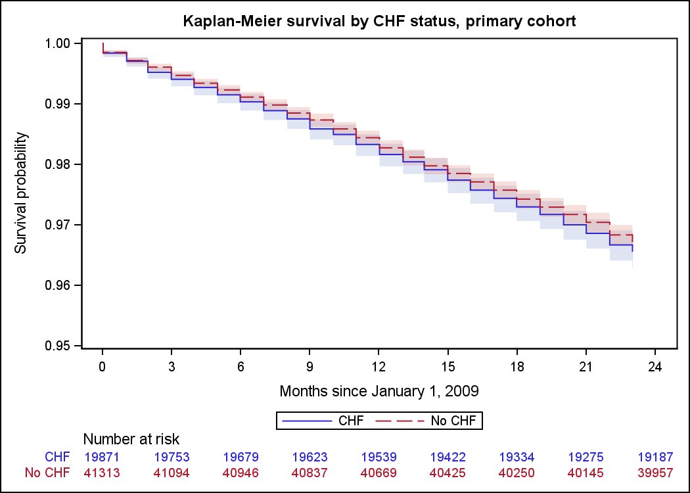
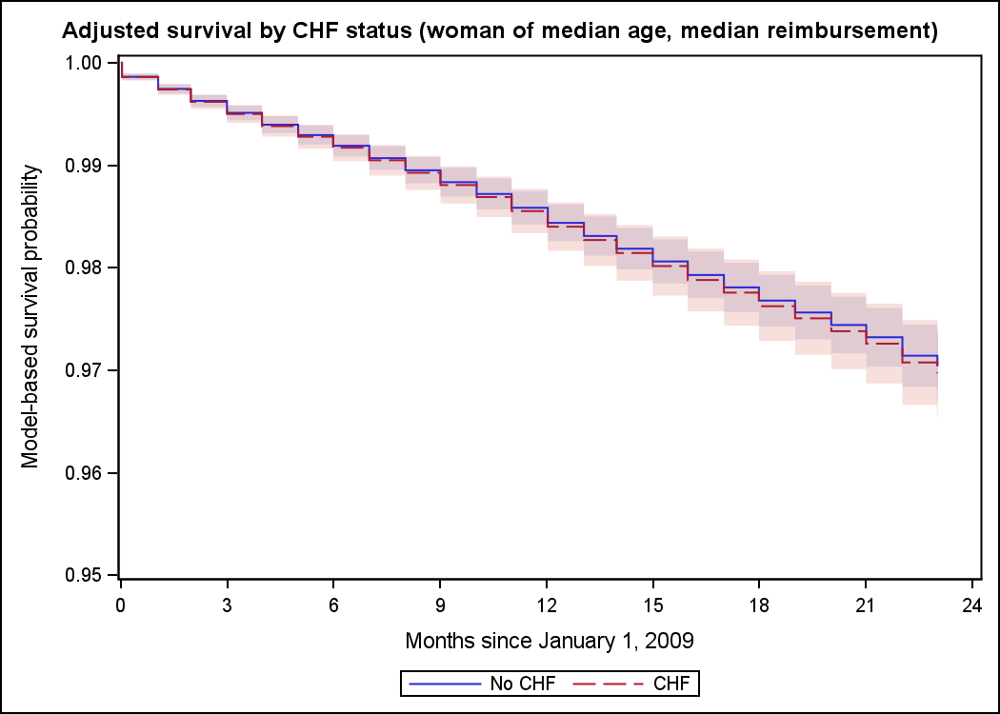
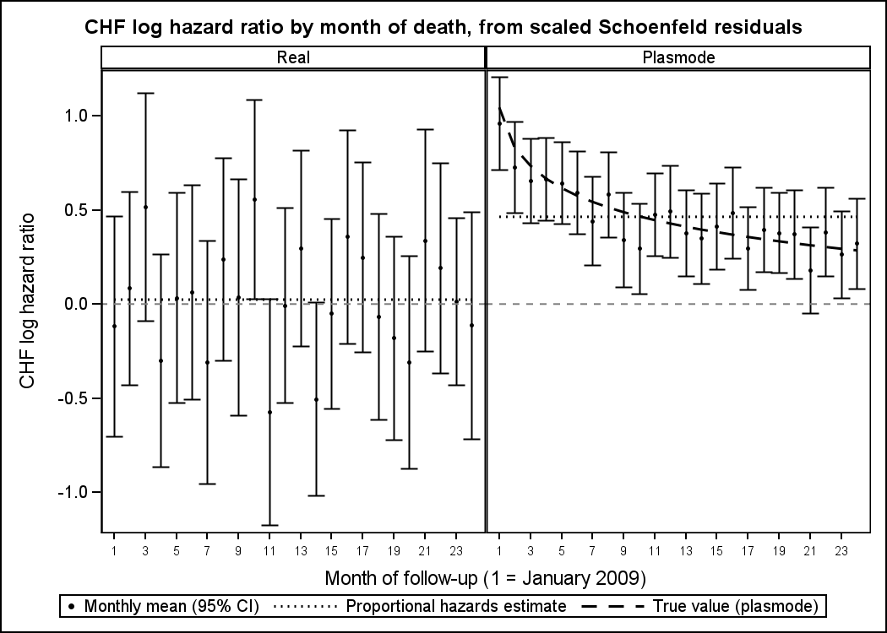
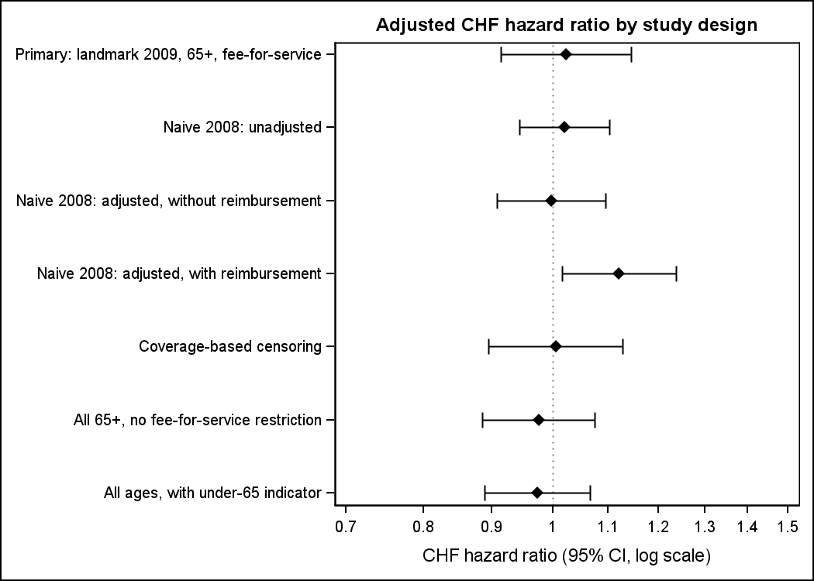
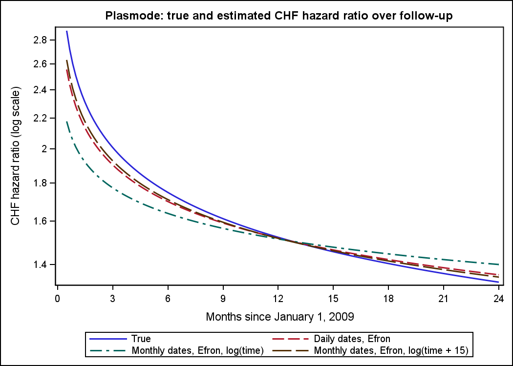
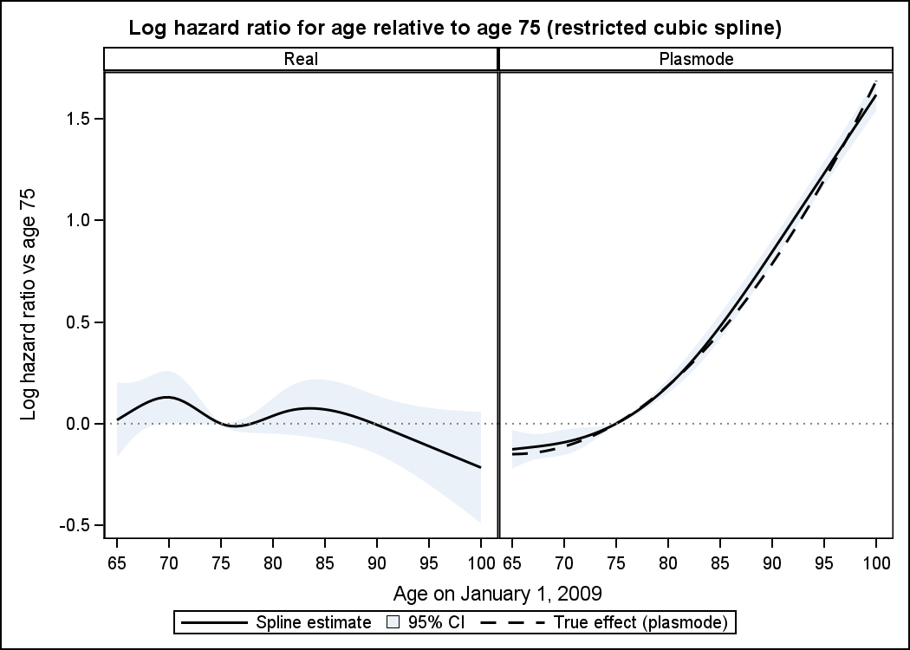

# Survival Analysis in SAS on CMS DE-SynPUF Beneficiary Summary Files

This repository demonstrates a landmark time-to-event analysis of all-cause mortality written in SAS, using the Centers for Medicare and Medicaid Services (CMS) Data Entrepreneurs' Synthetic Public Use File (DE-SynPUF). It follows the University of California, Los Angeles, Office of Advanced Research Computing (UCLA OARC) seminar on survival analysis in SAS, and adds an independent validation in Python, a set of design sensitivity analyses, and a plasmode simulation with known true parameters.

> **Synthetic data notice.** DE-SynPUF is synthetic. CMS altered the relationships between variables to protect beneficiary privacy, and in Sample 1 the death indicator is essentially independent of every covariate, including age. The estimates in this repository demonstrate methods. They are not clinical findings and should not be read as evidence about congestive heart failure or mortality.

> **Validation.** `sas/run_all.sas` compares 704 reference values with the SAS results as it runs. The reference values are computed independently in Python by `validation/cross_check.py`, which builds the cohorts and fits the survival models from the raw files without using any SAS output. The latest full run, on SAS 9.4M7, passed all 704 comparisons with a SAS condition code (SYSCC) of 0, which means no step ended with a warning or an error. After running the pipeline yourself, the Log window ends with the line `[check] SUMMARY PASS=724 FAIL=0 SKIP=0 UNCHECKED=0 of 704 reference values`. PASS is higher than 704 because 17 further checks compare results with stated ranges or known true values rather than with Python, and three values are checked twice.

## Main findings

- On data where death is unrelated to congestive heart failure (CHF), every correctly designed analysis finds no effect, with a CHF hazard ratio of 1.02 (95 percent confidence interval 0.91 to 1.15) in the primary cohort.
- Death dates recorded only to the month bias a time-varying effect unless time is measured from the middle of the month. In the plasmode simulation described below, coverage of the 95 percent interval rises from 0.35 to 0.98.
- Adjusting for a covariate measured after time zero creates a spurious CHF hazard ratio of 1.12 (95 percent confidence interval 1.02 to 1.24), which the landmark design prevents.

## Question and design

The question is whether a standard survival analysis workflow, applied to claims-style enrollment data, finds no association between congestive heart failure (CHF) and two-year all-cause mortality where none exists, and recovers known effects where they are built in. In this synthetic release death is unrelated to CHF, so the real data act as a negative control, and a plasmode simulation supplies a positive control with known effects.

The Beneficiary Summary Files record chronic conditions as annual flags built from a whole year of claims. Starting follow-up on January 1, 2008 and using the 2008 flags would let information from inside the follow-up period define exposure, which is a look-ahead problem. The analysis therefore uses a landmark design. Covariates come from 2008, follow-up starts on January 1, 2009, and administrative censoring is on December 31, 2010. The primary cohort is restricted to beneficiaries with 12 months of Part A and Part B coverage and no Medicare Advantage enrollment in 2008 (fee-for-service), because the 2008 condition flags are only complete for people whose claims all reach Medicare. Every birth and death date in DE-SynPUF falls on the first of a month, so time is effectively measured in months. `docs/methods.md` records every design decision and its rationale.

## Data

The analysis uses the 2008, 2009, and 2010 Beneficiary Summary Files from [CMS DE-SynPUF Sample 1](https://www.cms.gov/data-research/statistics-trends-and-reports/medicare-claims-synthetic-public-use-files/cms-2008-2010-data-entrepreneurs-synthetic-public-use-file-de-synpuf). The claims files are not used. A companion repository, [synpuf-omop-etl](https://github.com/eugenehernandez/synpuf-omop-etl), converts the same sample to the Observational Medical Outcomes Partnership (OMOP) Common Data Model.

## Attrition

| Step | Description | Remaining | Excluded |
|---:|---|---:|---:|
| 1 | Beneficiaries in the 2008 Beneficiary Summary File | 116,352 | |
| 2 | Death recorded on or before December 31, 2008 | 114,538 | 1,814 |
| 3 | Alive but absent from the 2009 file | 114,538 | 0 |
| 4 | Younger than 65 on January 1, 2009 | 95,730 | 18,808 |
| 5 | Not fee-for-service (12 months of Part A and Part B, no Medicare Advantage) in 2008 | 61,184 | 34,546 |

The primary cohort has 61,184 beneficiaries and 2,040 deaths over two years of follow-up. No one was censored for loss to follow-up, because every beneficiary alive at the end of 2009 appears in the 2010 file. Source is `results/tables/attrition.csv`. The coverage-censoring sensitivity analysis adds a sixth step that excludes 6,109 people who switched to Medicare Advantage or lost Part A coverage in 2009 without dying that year, which leaves 55,075 (`results/tables/attrition_coverage.csv`).

## Key figures

Kaplan-Meier survival by CHF status in the primary cohort, with the number at risk every three months.



Model-based survival from the adjusted Cox model for a White woman of median age and median 2008 reimbursement with none of the other chronic conditions, with and without CHF.



One diagnostic, shown on the real data and on the plasmode data side by side. Each point is the CHF log hazard ratio implied by the scaled Schoenfeld residuals for deaths in one month. The plasmode data were built with a CHF effect that fades over time, and the diagnostic recovers that pattern, while the real data show no pattern.



## Main results

Hazard ratios (HR) for CHF with 95 percent confidence intervals (CI), primary cohort. Source is `results/tables/cox_models.csv` and `results/tables/cox_interaction_hr.csv`.

| Model | CHF HR (95% CI) |
|---|---|
| Unadjusted, Efron ties | 1.05 (0.96 to 1.15) |
| Unadjusted, Breslow ties | 1.05 (0.96 to 1.15) |
| Adjusted for age, sex, race, end-stage renal disease, ten other chronic conditions, and 2008 reimbursement | 1.02 (0.91 to 1.15) |
| Adjusted with interactions, man aged 80 | 1.01 (0.86 to 1.19) |
| Adjusted with interactions, woman aged 80 | 1.09 (0.95 to 1.26) |

Two-year Kaplan-Meier survival is 0.966 with CHF and 0.967 without it, and the log-rank test gives p = 0.30 (`results/tables/km_estimates.csv` and `results/tables/group_tests.csv`). The restricted mean survival time to day 730 differs by less than one day between the groups (`results/tables/rmst.csv`). A CHF by log(time) term has a coefficient of -0.014 with a standard error of 0.033.

<!-- INTERPRETATION: rewrite in your own words -->
Every estimate for CHF is close to 1 with an interval that includes 1, which is the expected result in a release where death is unrelated to the covariates. The workflow behaves as it should on a negative control. Among the adjusted covariates, female sex has an interval that just excludes 1 (HR 0.91, 95% CI 0.84 to 1.00). With 18 covariates tested at the 5 percent level, about one such result is expected by chance, so it is not read as a finding.
<!-- END INTERPRETATION -->

## Sensitivity analyses

The same adjusted Cox model was fitted in five study designs to show how much analyst design decisions move the estimate. The table gives the CHF hazard ratio in each. The naive design is shown three ways to make the source of its result visible. Source is `results/tables/sensitivity_chf.csv`.

| Design | People | Deaths | CHF HR (95% CI) |
|---|---:|---:|---|
| Primary (landmark January 1, 2009, age 65 and older, fee-for-service) | 61,184 | 2,040 | 1.02 (0.91 to 1.15) |
| Naive (time zero January 1, 2008), unadjusted | 59,380 | 2,904 | 1.02 (0.95 to 1.10) |
| Naive, adjusted without 2008 reimbursement | 59,380 | 2,904 | 1.00 (0.91 to 1.10) |
| Naive, fully adjusted | 59,380 | 2,904 | 1.12 (1.02 to 1.24) |
| Coverage-based censoring | 55,075 | 1,933 | 1.01 (0.90 to 1.13) |
| All ages 65 and older, no fee-for-service restriction | 95,730 | 3,139 | 0.98 (0.89 to 1.08) |
| All ages, with an indicator for younger than 65 | 114,538 | 3,647 | 0.97 (0.89 to 1.07) |



<!-- INTERPRETATION: rewrite in your own words -->
Four of the five designs give a CHF hazard ratio near 1, which is consistent with data that contain no real effect of CHF on death. The fully adjusted naive design gives 1.12 (95 percent CI 1.02 to 1.24). This is a modest spurious effect with a known cause, not a large or certain bias, and its interval only narrowly excludes 1.

The cause is a covariate measured after time zero. The naive design starts follow-up on January 1, 2008 but adjusts for total 2008 Medicare reimbursement, which people who die early in 2008 have less time to accumulate. The covariate is therefore partly caused by the outcome. CHF is strongly correlated with reimbursement, so adjusting for it pushes the CHF hazard ratio up. Without the reimbursement term the naive hazard ratio is 0.998, and without any adjustment it is 1.02. The landmark design avoids the problem because every covariate is measured before follow-up begins. The mechanism and its supporting numbers are described in `docs/methods.md`, and the numbers are in `results/tables/sensitivity_naive_mechanism.csv`.
<!-- END INTERPRETATION -->

## Plasmode simulation

The real outcome carries no signal, so a plasmode data set supplies one. It keeps the real covariates of all 61,184 people in the primary cohort and replaces the outcome with survival times generated from a Weibull model whose parameters are known. The CHF log hazard ratio is a + b log(time), with a = 1.6 and b = -0.2, so the CHF hazard ratio falls from about 2.5 at one month to 1.3 at two years. Age has a quadratic effect, diabetes has a hazard ratio of 1.3, female sex has a hazard ratio of 0.8, and every other covariate has no effect. Every simulated date is moved to the first of its month, as DE-SynPUF does. The random draws are computed from a hash of each beneficiary ID, so Python rebuilds exactly the same data set and every plasmode estimate is part of the validation. The true values are in `results/tables/plasmode_truth.csv` and the generated outcome is summarized in `results/tables/plasmode_summary.csv`.



Across 100 simulated outcomes on 20,000 people, evaluating the time term at the first of the month gives badly biased estimates of the time-varying CHF effect, and evaluating it at the middle of the month recovers the truth. Source is `results/tables/plasmode_replicates.csv`, and the fits on the full plasmode cohort are in `results/tables/plasmode_recovery.csv`.

| Plasmode result (100 replicates, n = 20,000) | Mean of a (true 1.6) | Mean of b (true -0.2) | 95% CI coverage, a and b |
|---|---|---|---|
| Monthly dates, log(time), Efron ties | 1.246 | -0.141 | 0.35 and 0.42 |
| Monthly dates, log(time), Breslow ties | 1.240 | -0.140 | 0.34 and 0.40 |
| Monthly dates, log(time + 15), Efron ties | 1.664 | -0.211 | 0.98 and 0.97 |

<!-- INTERPRETATION: rewrite in your own words -->
The date resolution, not the ties method, decides whether the time-varying CHF effect is recovered. With dates on the first of the month, every January death is evaluated at day 1, where log(time) is 0, and the fit misreads how fast the effect fades. Evaluating the term at the middle of the month brings coverage back to the nominal 95 percent. Efron and Breslow ties differ by 0.005 or less in each coefficient. The other built-in effects (age, diabetes, and female sex) are recovered in every fit.
<!-- END INTERPRETATION -->

## Diagnostics on real and plasmode data

Programs `07` to `09` run the same diagnostics on the real cohort and on the plasmode data. Most figures put the two side by side, so each diagnostic can be seen staying flat when there is nothing to find and detecting an effect that was built in.

| Diagnostic | Figure | Table |
|---|---|---|
| Functional form of age, martingale residuals by single year of age | `results/figures/ff_martingale_age.png` | |
| Functional form of age, restricted cubic spline with the true curve | `results/figures/ff_spline_age.png` | `results/tables/ff_spline_tests.csv` |
| Functional form of age, cumulative martingale residuals (subsample) | `results/figures/ff_assess_age_real.png`, `results/figures/ff_assess_age_plasmode.png` | `results/tables/ff_assess_suptest.csv` |
| Proportional hazards, log of negative log survival by CHF | `results/figures/ph_loglog_chf.png` | |
| Proportional hazards, scaled Schoenfeld residuals by month | `results/figures/ph_schoenfeld_chf.png` | |
| Proportional hazards, CHF hazard ratio by period of follow-up | `results/figures/ph_piecewise_chf.png` | `results/tables/ph_piecewise_chf.csv` |
| Proportional hazards, covariate by time interactions | | `results/tables/ph_time_interactions.csv` |
| Proportional hazards, standardized score process (subsample) | `results/figures/ph_score_chf_real.png`, `results/figures/ph_score_chf_plasmode.png` | `results/tables/ph_assess_suptest.csv` |
| Influence, change in the CHF coefficient for each person | `results/figures/inf_dfbeta_chf.png` | `results/tables/influence_summary.csv` |
| Influence, likelihood displacement | `results/figures/inf_ld.png` | `results/tables/influence_refit.csv` |



<!-- INTERPRETATION: rewrite in your own words -->
On the plasmode data the spline traces the true age curve closely and the test of nonlinearity is strongly significant (likelihood ratio chi-square 178 on 3 degrees of freedom), while on the real data it is not (4.3, p = 0.23). The piecewise CHF hazard ratio on the plasmode data falls from 2.04 in months 1 to 6 to 1.42 in months 13 to 24, inside the true range for each period, and stays near 1 on the real data. A time-interaction test in the working model wrongly flags diabetes on the plasmode data, but the flag disappears once age and the CHF effect are specified correctly. `docs/methods.md` explains why. In both data sets, no single person moves the CHF, age, sex, or diabetes coefficient by more than a tenth of its standard error.
<!-- END INTERPRETATION -->

## Validation

`validation/cross_check.py` rebuilds every cohort from the three raw files and implements its own Kaplan-Meier, Nelson-Aalen, log-rank, restricted mean survival time, and Cox model code (Efron and Breslow ties, time-varying terms, score residuals, and the influence approximations) in numpy and scipy. It does not read any SAS output. Its survival code is first checked against published results for the Freireich leukemia data with `python validation/cross_check.py --selftest`. It then writes 704 reference values to `validation/expected_values.csv`. Each SAS program compares its results with those values and writes a PASS or FAIL line to the log, and `run_all.sas` ends with a tally. A few values side by side are shown below.

| Quantity | SAS | Python |
|---|---|---|
| Primary cohort size | 61,184 | 61,184 |
| Deaths in the primary cohort | 2,040 | 2,040 |
| Log-rank chi-square, CHF | 1.0753 | 1.0753 |
| Adjusted CHF hazard ratio | 1.023544 | 1.023544 |
| Naive fully adjusted CHF hazard ratio | 1.121449 | 1.121449 |
| Plasmode deaths | 10,395 | 10,395 |
| Plasmode CHF intercept a, daily dates | 1.380724 | 1.380724 |
| Largest likelihood displacement, real data | 0.04386 | 0.04386 |

Results that depend on resampling inside SAS, such as the p-values of the cumulative residual tests, cannot be reproduced outside SAS and are reported without a check.

## How to run

1. Install SAS 9.4 with SAS/STAT 15.1 or later. The programs use only Base SAS, SAS/STAT, and ODS Graphics, and run in SAS Enterprise Guide, SAS Studio, or the SAS windowing environment.
2. Download and unzip the three DE-SynPUF Sample 1 Beneficiary Summary Files. Unzip this repository outside any OneDrive-synced folder, because SAS writes datasets to `_work/` and OneDrive file locks can interrupt those writes.
3. Copy `sas/local_config_template.sas` to `sas/local_config.sas` and change its `data_root` line to your data folder. That file is listed in `.gitignore`, so your local path never reaches the repository. On a shared SAS server you can instead set the `SYNPUF_DATA_ROOT` environment variable. If your folder layout differs from the CMS download, adjust the three file names in section 3b of `sas/00_config.sas`.
4. Open `sas/run_all.sas` from disk and submit it. The full log is written to a time-stamped file in `_work/`, because it is too long for the Log window of the SAS windowing environment. When the run ends, the Log window shows the log file name, the number of ERROR and WARNING lines in it, the highest SAS condition code (SYSCC), and the line `[check] SUMMARY PASS=n FAIL=n SKIP=n UNCHECKED=n of N`, which counts every comparison with the Python reference values. FAIL, SKIP, UNCHECKED, SYSCC, and the ERROR count should all be 0. If any error occurred, the summary line is a WARNING that says ERRORS OCCURRED. If a run is stopped early, submit `proc printto; run;` to send the log back to the Log window.
5. Optionally, run `python validation/cross_check.py` to rebuild the reference values, or `python validation/cross_check.py --selftest` to check the Python survival code against the Freireich data. The script needs pandas, numpy, and scipy, and reads the data location from `sas/local_config.sas`. If Python runs on a different machine from SAS, set the `SYNPUF_DATA_ROOT` environment variable to the data folder, which takes precedence.

Each program can also be run alone after `01` to `03` have created the analysis datasets, and `06b_plasmode.sas` must run before `07` to `09`.

## Tested with

SAS 9.4M7 with SAS/STAT 15.2 on Windows, and Python 3.13 with numpy 2.5, pandas 3.0, and scipy 1.18. A full run of `run_all.sas` took about 70 minutes. Two optional steps account for most of that time, the plasmode replicate study (about 16 minutes) and the cumulative residual tests of the ASSESS statement (the plasmode proportional hazards test alone took about 35 minutes). Setting `plas_reps` to 0 or `run_assess` to 0 in `sas/00_config.sas` skips them. Neither changes the check tally, because the replicate study can be skipped on both sides and the resampling tests have no Python reference values. The Python cross-check takes about 10 minutes.

## Repository structure

```
README.md
LICENSE
.gitignore
sas/
  00_config.sas            data location logic, input files, library, formats, ODS settings, check macros
  local_config_template.sas  copy to local_config.sas and set data_root (local_config.sas is not committed)
  01_import.sas            DATA step import of the three Beneficiary Summary Files
  02_profile.sas           data quality and cross-year consistency checks
  03_build_cohort.sas      landmark cohort, attrition, sensitivity cohorts
  04_explore.sas           seminar section 2, Table 1, follow-up, correlations
  05_nonparametric.sas     seminar section 3, Kaplan-Meier, Nelson-Aalen, tests, RMST, hazard
  06_cox.sas               seminar section 5, Cox models, interactions, adjusted curves
  06b_plasmode.sas         plasmode simulation, recovery table, replicate study
  07_functional_form.sas   seminar section 6, real and plasmode data
  08_ph_assumption.sas     seminar section 7, real and plasmode data
  09_influence.sas         seminar section 8, real and plasmode data
  10_sensitivity.sas       design sensitivity analyses
  run_all.sas              runs everything in order and reports the check tally
validation/
  cross_check.py           independent Python reproduction of every checked value
  expected_values.csv      704 reference values
  attrition_python.csv     attrition table computed in Python
results/
  tables/                  aggregated CSVs only
  figures/                 PNG figures
docs/
  methods.md               design decisions, assumptions, and deviations
```

## Results files

Every file in `results/` is aggregated. None holds a row for an individual beneficiary.

| File | Content |
|---|---|
| `tables/profile_checks.csv` | Data quality and consistency counts |
| `tables/attrition.csv`, `tables/attrition_coverage.csv` | Attrition for the primary and coverage-censoring cohorts |
| `tables/cohort_summary.csv` | Size, deaths, and person-time of each analysis population |
| `tables/table1.csv`, `tables/correlations.csv` | Baseline characteristics by CHF status and covariate correlations |
| `figures/followup_deaths_hist.png` | Month of death among people who died |
| `tables/km_estimates.csv`, `tables/group_tests.csv`, `tables/rmst.csv` | Kaplan-Meier and Nelson-Aalen estimates, group tests, and restricted mean survival time |
| `figures/km_chf.png`, `figures/km_chf_lifetest.png` | Kaplan-Meier curves, drawn with PROC SGPLOT and with the PROC LIFETEST default plot |
| `figures/cumhaz_chf.png`, `figures/hazard_chf.png` | Nelson-Aalen cumulative hazard and kernel-smoothed hazard by CHF |
| `tables/cox_models.csv`, `tables/cox_interaction_hr.csv`, `figures/adjusted_survival_chf.png` | Cox models, interaction hazard ratios, and adjusted survival curves |
| `tables/plasmode_*.csv`, `figures/plasmode_chf_tv.png` | Plasmode truth, summary, recovery, and replicate study |
| `tables/ff_*.csv`, `tables/ph_*.csv`, `tables/influence_*.csv`, and the matching figures | Diagnostics, listed in the diagnostics table above |
| `tables/sensitivity_chf.csv`, `tables/sensitivity_naive_mechanism.csv`, `figures/sensitivity_chf.png` | Design sensitivity analyses |

## Limitations

DE-SynPUF is synthetic, and in Sample 1 death is unrelated to the covariates, so no estimate here says anything about real beneficiaries. Death dates resolve only to the month, which creates heavy ties and, as the plasmode simulation shows, distorts time-varying effects unless they are evaluated at the middle of the month. The chronic condition flags are annual and switch on and off between years, so exposure is fixed at its 2008 value and changes during follow-up are not modeled. Coverage months are counts rather than dates, so the coverage-based censoring assumes they run continuously from January. The covariates come only from the Beneficiary Summary Files, so severity is represented by total reimbursement rather than by diagnoses or procedures from the claims. The cumulative residual tests run on a subsample of 10,000 people. The plasmode simulation explores one set of true values, so its conclusions apply to effects of that form and size.

## References

- UCLA Office of Advanced Research Computing. Introduction to Survival Analysis in SAS. https://stats.oarc.ucla.edu/sas/seminars/sas-survival/
- Hosmer DW, Lemeshow S, May S. *Applied Survival Analysis: Regression Modeling of Time-to-Event Data*. 2nd ed. Wiley, 2008.
- Centers for Medicare and Medicaid Services. CMS 2008-2010 Data Entrepreneurs' Synthetic Public Use File (DE-SynPUF) User Manual and Codebook.
- SAS Institute. SAS/STAT User's Guide, The LIFETEST Procedure and The PHREG Procedure.
- Lin DY, Wei LJ, Ying Z. Checking the Cox model with cumulative sums of martingale-based residuals. *Biometrika*. 1993;80(3):557-572.
- Grambsch PM, Therneau TM. Proportional hazards tests and diagnostics based on weighted residuals. *Biometrika*. 1994;81(3):515-526.
- Harrell FE. *Regression Modeling Strategies*. 2nd ed. Springer, 2015.
- Franklin JM, Schneeweiss S, Polinski JM, Rassen JA. Plasmode simulation for the evaluation of pharmacoepidemiologic methods in complex healthcare databases. *Computational Statistics and Data Analysis*. 2014;72:219-226.
- Freireich EJ et al. The effect of 6-mercaptopurine on the duration of steroid-induced remissions in acute leukemia. *Blood*. 1963;21(6):699-716.

## Author

Eugene Hernandez · [github.com/eugenehernandez](https://github.com/eugenehernandez/) · [linkedin.com/in/eugenehernandez](https://linkedin.com/in/eugenehernandez/)
